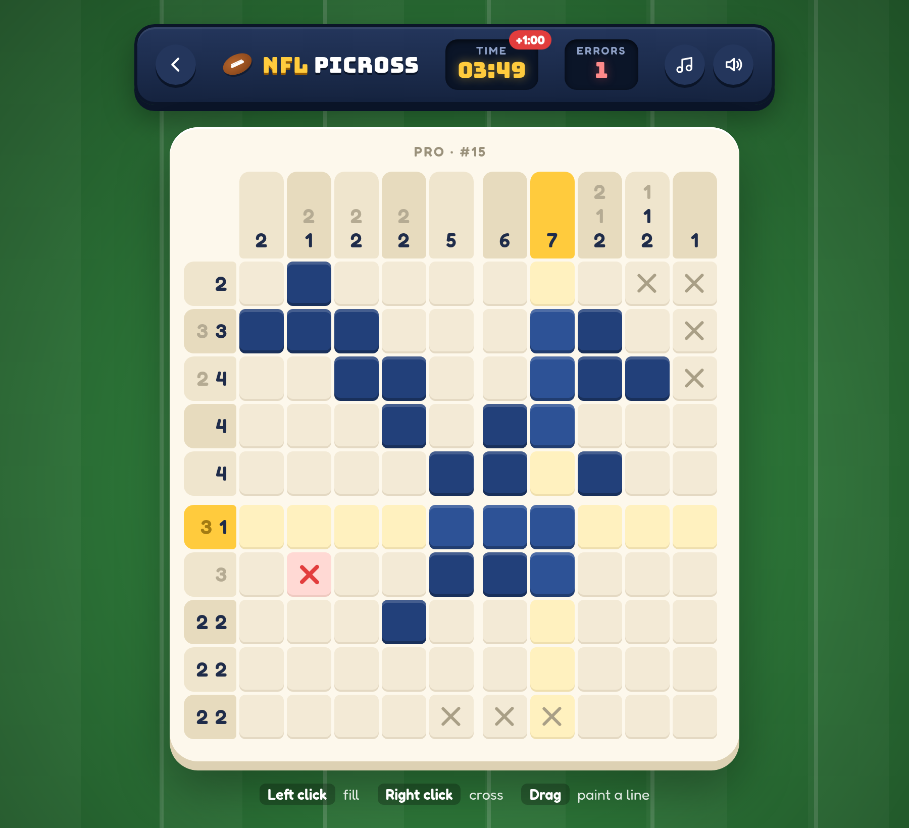
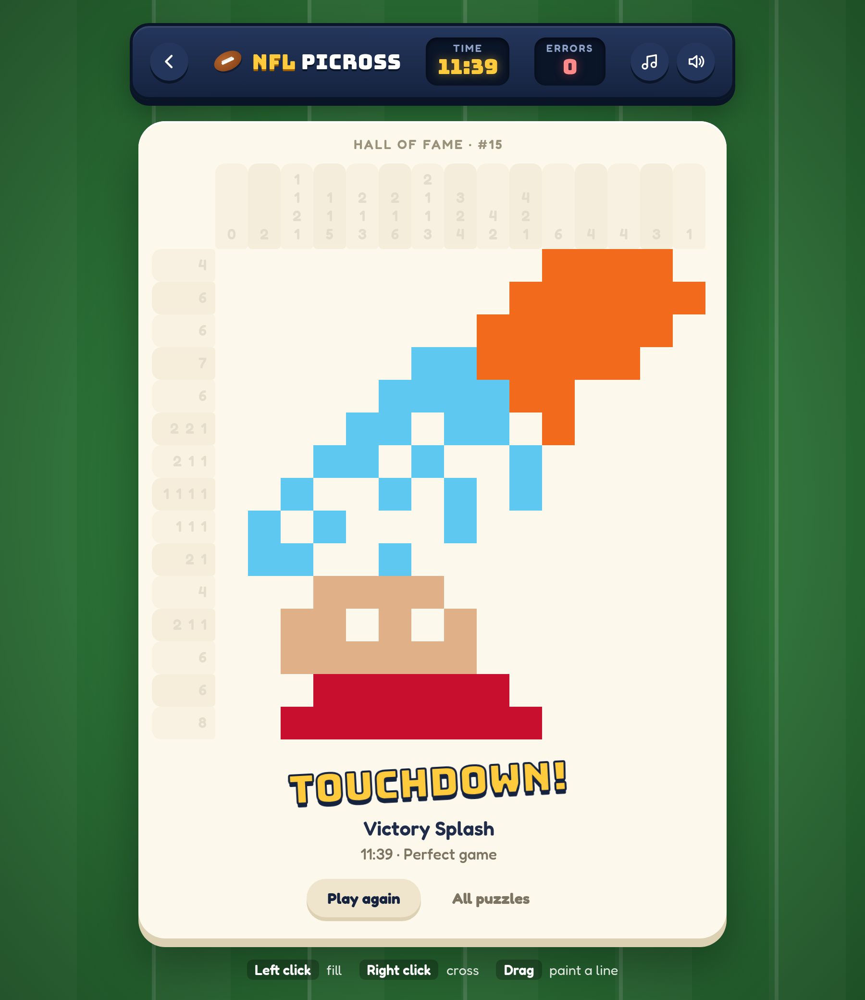
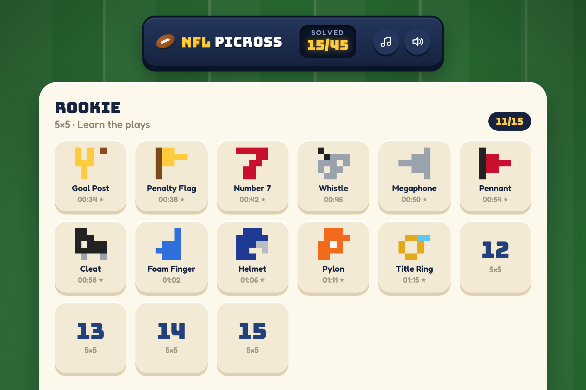
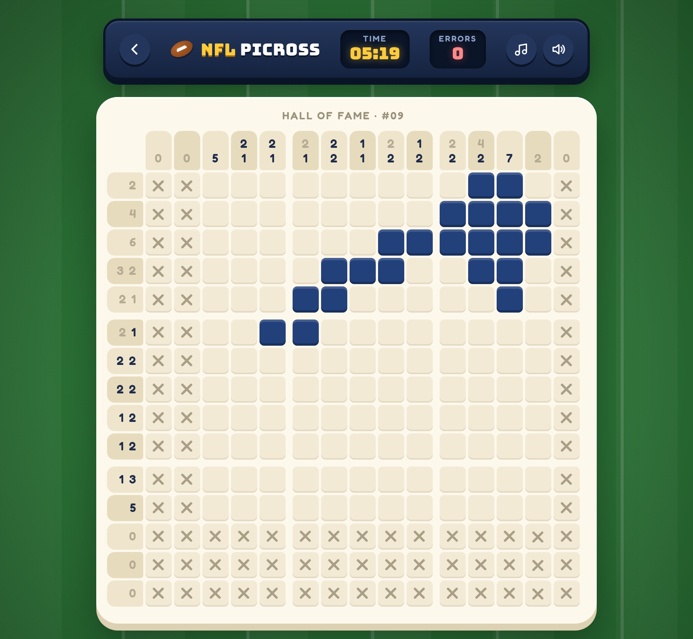

# NFL Picross

A football-themed picross (nonogram) game that runs in the browser. Fill in the grid using the number clues and uncover a pixel-art picture: helmets, goal posts, touchdown dives, victory splashes and more.

**[▶ Play it on GitHub Pages](https://onra.github.io/nfl-picross/)**

<p align="center">
  
</p>

## How to play

Each number tells you the length of a run of filled cells in that row or column, in order, with at least one empty cell between runs. Use logic to work out which cells are filled. Every puzzle has a single solution you can reach without guessing.

| Action | Control |
| --- | --- |
| Fill a cell | Left click |
| Mark a cell as empty | Right click |
| Paint a whole line | Hold and drag |
| Erase a cross | Click it again |

The rules follow the Nintendo picross style:

- **Mistakes are caught right away.** Filling a wrong cell turns it into a red cross and adds a time penalty that doubles each time: +1, +2, +4, then +8 minutes.
- **Clues grey out as you go.** A number turns grey once its block is filled and its position is certain from what is on the board. This never gives away the solution.
- **Empty lines start crossed.** Rows and columns with a `0` clue are filled in with crosses for you.
- **Solve it to reveal the picture.** The grid closes up into a full-color pixel-art image.

<p align="center">
  
</p>

## Puzzles

There are 45 puzzles in three packs, each ordered from easiest to hardest:

| Pack | Size | Feel |
| --- | --- | --- |
| Rookie | 5×5 | Learn the plays |
| Pro | 10×10 | Game day |
| Hall of Fame | 15×15 | Legends only |

The home screen tracks your progress. A solved puzzle shows its picture, your best time and a ★ for a game with no errors. Puzzle titles stay hidden until you solve them, since they would give the answer away. Progress is saved in your browser.

<p align="center">
  
</p>

<p align="center">
  
</p>

## Sound

All sound is synthesized in the browser with the Web Audio API; there are no audio files.

- **Effects:** filling cells while dragging climbs a pentatonic scale, completed lines chime, mistakes buzz and a win plays a fanfare.
- **Music:** an arcade fight-song loop with a chiptune lead, brass stabs and a marching drumline.
- **Controls:** the music button turns the music on or off, and the speaker button opens a volume slider.

## Running locally

You need [Node.js](https://nodejs.org/) 22.12 or later.

```sh
npm install
npm run dev      # start the dev server at http://localhost:5173
npm test         # run the test suite
npm run build    # type-check and build to dist/
```

The game is written in TypeScript with [Vite](https://vite.dev/) and no UI framework. Tests use [Vitest](https://vitest.dev/).

## Adding a puzzle

Puzzles are JSON files in `src/puzzles/<pack>/`. The number at the start of the filename sets the order within the pack.

```json
{
  "id": "rookie-01",
  "title": "Goal Post",
  "palette": { "Y": "#ffcb3d", "B": "#8b4a1f" },
  "grid": [
    "Y.Y.B",
    "Y.Y..",
    "YYY..",
    ".Y...",
    ".Y..."
  ]
}
```

A `.` is an empty cell. Any other letter is a filled cell, and its palette color is used when the picture is revealed.

`npm test` checks every puzzle file:

- **Uniqueness:** the puzzle must be solvable by line logic alone, with exactly one solution.
- **Asymmetry:** the picture must not be close to a left-right mirror image. Symmetric pictures make dull puzzles.
- **Difficulty:** 10×10 and larger puzzles must need at least 3 passes of deduction, so the clues don't give the picture away at a glance.

## Project layout

```
src/
  main.ts           hash router: home screen or a puzzle
  home.ts           puzzle select screen
  ui.ts             puzzle screen: board, input, timer, win reveal
  game.ts           game rules: actions, errors, penalties, clue status
  solver.ts         line-logic solver used for clue status and puzzle checks
  puzzle.ts         puzzle parsing and clue computation
  audio.ts          synthesized sound effects and music
  progress.ts       best times, stored in localStorage
  puzzles/          puzzle packs
tests/              Vitest tests
```

## Disclaimer

This is a fan project. It is not affiliated with, endorsed by or connected to the National Football League. The puzzles use generic football imagery and no team names or logos.
